# Diseño Guiado por el Dominio 

Para comprender el problema, hay que entender el contexto en el que existe: la estrategia empresarial de la organización y el valor que busca obtener al desarrollar el software.

**Tipos de Subdominios**
- Núcleo (Core): Un subdominio núcleo es lo que una empresa hace de manera diferente a sus competidores. Esto puede implicar inventar nuevos productos o servicios o reducir costos optimizando procesos existentes. El subdominio núcleo es el corazón del negocio.
- De Soporte (Supporting): Como su nombre indica, los subdominios de soporte respaldan el negocio de la empresa. Sin embargo, a diferencia de los subdominios núcleo, los subdominios de soporte no brindan ninguna ventaja competitiva.
- Genéricos: Los subdominios genéricos son actividades empresariales que todas las empresas realizan de la misma manera. _los subdominios genéricos no brindan ninguna ventaja competitiva a la empresa_ 

## Dominio Empresarial
Un dominio empresarial define el área principal de actividad de una empresa. En términos generales, es el servicio que la empresa ofrece a sus clientes.
_Una empresa puede operar en múltiples dominios empresariales._ 

## Subdominio
Para alcanzar los objetivos y metas de su dominio empresarial, una empresa debe operar en múltiples subdominios. Un subdominio es un área de actividad empresarial de grano fino. _Los subdominios deben interactuar entre sí para lograr los objetivos de la empresa en su dominio empresarial._ 

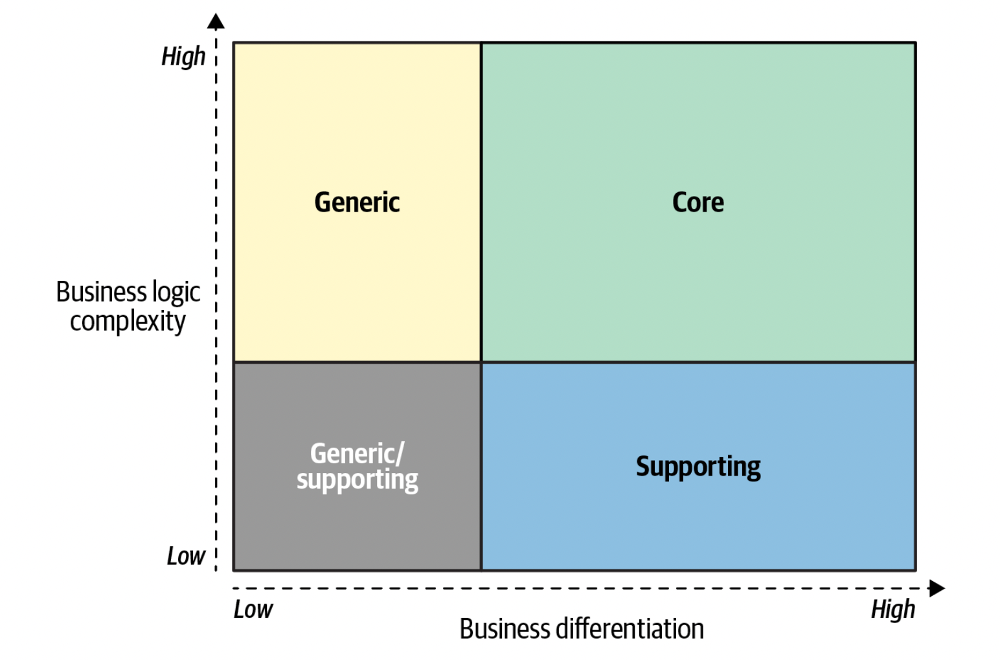

A diferencia de los subdominios núcleo, los subdominios de soporte no cambian con frecuencia. 

Todos los subdominios son necesarios para que la empresa funcione en su dominio empresarial. Los subdominios son como bloques constructivos fundamentales: quite uno y toda la estructura podría derrumbarse. Dado que se espera que los requisitos de los subdominios núcleo cambien con frecuencia y de manera continua, la solución debe ser mantenible y fácil de evolucionar. Por lo tanto, los subdominios núcleo requieren la implementación de las técnicas de ingeniería más avanzadas.

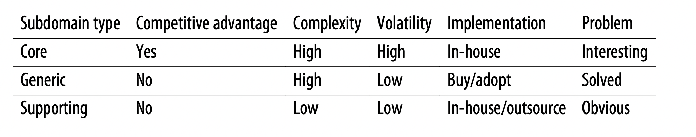

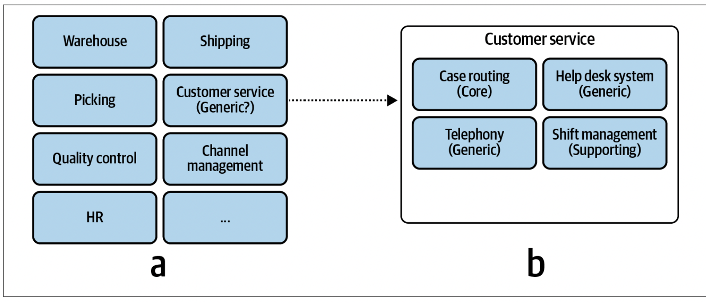

> Lo que se libera en producción es la (in)comprensión de los desarrolladores, no el conocimiento de los expertos en dominio.

expertos en dominio: es su trabajo especializarse y comprender todas las complejidades del dominio empresarial. En absoluto debemos, ni podemos, convertirnos en expertos en dominio. Dicho esto, es crucial que entendamos a los expertos en dominio y usemos la misma terminología empresarial que ellos.

> Como dice Alberto Brandolini1, el desarrollo de software es un proceso de aprendizaje; el código que funciona es un efecto secundario. El éxito de un proyecto de software depende de la efectividad del intercambio de conocimientos entre expertos en dominio e ingenieros de software. Tenemos que comprender el problema para poder resolverlo.

Las investigaciones sobre por qué fallan los proyectos de software han demostrado que la comunicación efectiva es esencial para el intercambio de conocimientos y el éxito del proyecto.

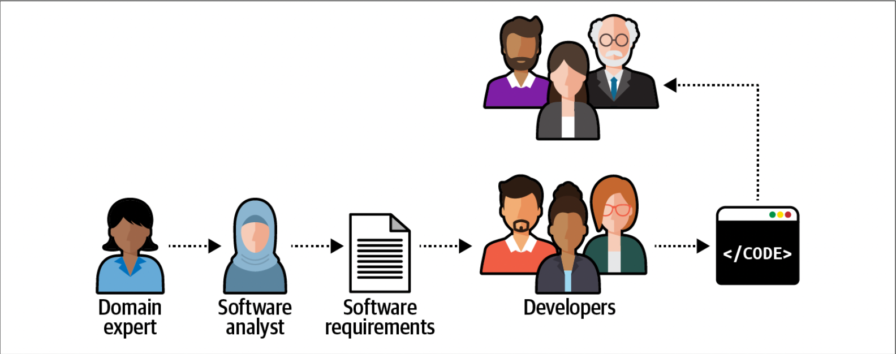

Durante el ciclo de vida tradicional de desarrollo de software, el conocimiento del dominio se “traduce” a una forma amigable para el ingeniero conocida como modelo de análisis, que es una descripción de los requisitos del sistema en lugar de una comprensión del dominio empresarial detrás de él. Aunque las intenciones pueden ser buenas, dicha mediación es perjudicial para el intercambio de conocimientos. 

## Lenguaje Ubicuo
El uso de un lenguaje ubicuo es la práctica fundamental del diseño guiado por el dominio. La idea es simple: si las partes necesitan comunicarse de manera eficiente, en lugar de depender de traducciones, deben hablar el mismo lenguaje.

- Conocimiento del dominio a un modelo de análisis
- Modelo de análisis a requisitos
- Requisitos a diseño del sistema
- Diseño del sistema a código fuente

El lenguaje ubicuo debe ser preciso y consistente. Debe eliminar la necesidad de suposiciones y hacer explícita la lógica del dominio empresarial.

- cada término del lenguaje ubicuo debe tener un y solo un significado
- Dos términos no pueden usarse indistintamente en un lenguaje ubicuo.

## Modelo
Un modelo es una representación simplificada de una cosa o fenómeno que enfatiza intencionalmente ciertos aspectos mientras ignora otros. Abstracción con un uso específico en mente. _Un modelo no es una copia del mundo real, sino una construcción humana que nos ayuda a dar sentido a los sistemas del mundo real._ 

**Todos los modelos tienen un propósito, y un modelo efectivo contiene solo los detalles necesarios para cumplir su propósito** En su esencia, un modelo es una abstracción. La noción de abstracción nos permite manejar la complejidad omitiendo detalles innecesarios y dejando solo lo necesario para resolver el problema en cuestión.
> el propósito de la abstracción no es ser vago, sino crear un nuevo nivel semántico en el que se pueda ser absolutamente preciso.

A pesar de las ventajas obvias de mantener un glosario de terminología relacionada con el proyecto, tiene una limitación inherente. Los glosarios funcionan mejor para “sustantivos”: nombres de entidades, procesos, roles, etc. Aunque los sustantivos son importantes, capturar el comportamiento es crucial.

“Maestro de muchas cosas, pero experto en ninguna”. Se supone que dichos modelos son adecuados para todo, pero al final son efectivos para nada.

## Contexto Delimitado
La solución en el diseño guiado por el dominio es trivial: dividir el lenguaje ubicuo en múltiples lenguajes más pequeños y asignar cada uno al contexto explícito en el que puede aplicarse: su contexto delimitado.


En cierto sentido, los conflictos terminológicos y los contextos implícitos son una parte inherente de cualquier negocio de tamaño decente. Con el patrón de contexto delimitado, los contextos se modelan como una parte explícita e integral del dominio empresarial.

### Límites del Modelo

Un modelo no puede existir sin un límite; se expandirá para convertirse en una copia del mundo real.

Los contextos delimitados definen la aplicabilidad de un lenguaje ubicuo y del modelo que representa. La terminología, los principios y las reglas comerciales de un lenguaje solo son consistentes dentro de su contexto delimitado. Un lenguaje ubicuo es ubicuo solo dentro de los límites de su contexto delimitado. 

El tamaño de un contexto delimitado, por sí solo, no es un factor decisivo. Los modelos no necesariamente deben ser grandes o pequeños. Los modelos deben ser útiles. Cuanto más amplio sea el límite del lenguaje ubicuo, más difícil será mantenerlo consistente. Cuanto más pequeños sean, mayor será la sobrecarga de integración que induce el diseño.

Por lo tanto, mantenga sus modelos útiles y alinee los tamaños de los contextos delimitados con sus necesidades comerciales y restricciones organizacionales.

Tener una relación uno a uno entre contextos delimitados y subdominios puede ser perfectamente razonable en algunos escenarios. En otros, sin embargo, diferentes estrategias de descomposición pueden ser más adecuadas.

Como discutimos anteriormente, un contexto delimitado puede contener múltiples subdominios. En tal caso, el contexto delimitado es un límite físico, mientras que cada uno de sus subdominios es un límite lógico. Los límites lógicos tienen diferentes nombres en distintos lenguajes de programación: espacios de nombres, módulos o paquetes.

Se puede decir que los contextos delimitados del diseño guiado por el dominio se basan en la noción lexicográfica de dominios semánticos. Un dominio semántico se define como un área de significado y las palabras utilizadas para hablar sobre él. Por ejemplo, las palabras monitor, puerto y procesador tienen significados diferentes en los dominios semánticos de la ingeniería de software y hardware.


## Integración de Contextos Delimitados
Además, los modelos en diferentes contextos delimitados pueden evolucionar e implementarse de forma independiente. Dicho esto, los contextos delimitados en sí mismos no son independientes. Así como un sistema no puede construirse con componentes independientes—los componentes deben interactuar entre sí para lograr los objetivos generales del sistema—, así también ocurre con las implementaciones en contextos delimitados. Aunque pueden evolucionar de forma independiente, deben integrarse. Como resultado, siempre habrá puntos de contacto entre contextos delimitados. Estos se llaman contratos.


- **Asociación (Partnership)**

Los contextos delimitados se integran de manera ad hoc.
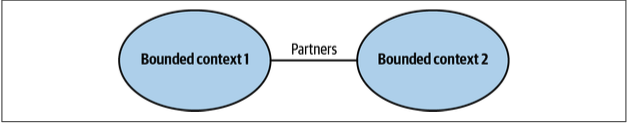
- **Núcleo Compartido (Shared Kernel)**

Dos o más contextos delimitados se integran compartiendo un modelo superpuesto limitado que pertenece a todos los contextos delimitados participantes.

Es crucial enfatizar que el modelo compartido se diseña según las necesidades de todos los contextos delimitados.

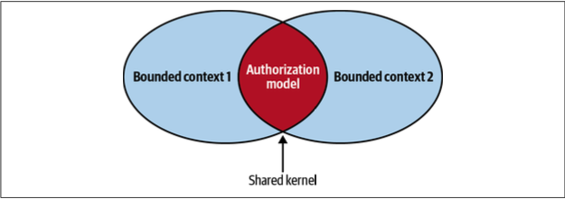

El criterio de aplicabilidad general para el patrón de núcleo compartido es el costo de la duplicación frente al costo de la coordinación. 

El núcleo compartido se aplicará naturalmente a los subdominios que cambian con más frecuencia: los subdominios núcleo.


- **Conformista**

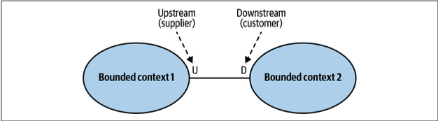

El consumidor se conforma al modelo del proveedor de servicios.

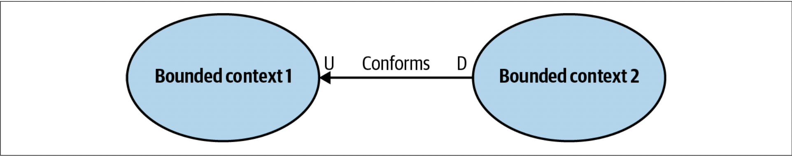

- **Capa Anticorrupción**

El consumidor traduce el modelo del proveedor de servicios a un modelo que se ajuste a las necesidades del consumidor.

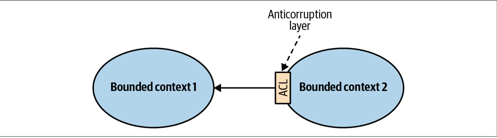

- **Servicio de Anfitrión Abierto**

El proveedor de servicios implementa un lenguaje publicado: un modelo optimizado para las necesidades de sus consumidores.

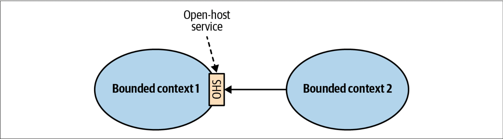

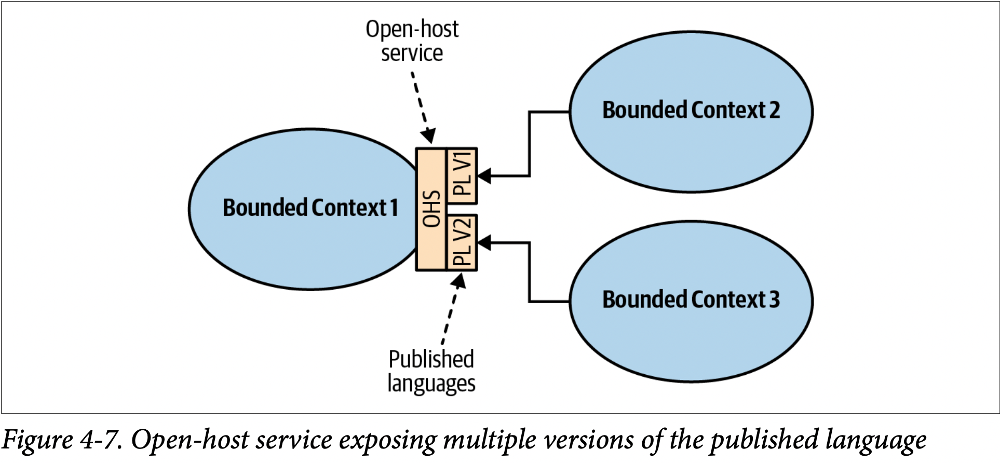
- **Vías Separadas**
Es menos costoso duplicar una funcionalidad específica que colaborar e integrarla.

# Mapa de Contextos

Después de analizar los patrones de integración entre los contextos delimitados de un sistema, podemos representarlos en un mapa de contextos. El mapa de contextos es una representación visual de los contextos delimitados del sistema y las integraciones entre ellos. 

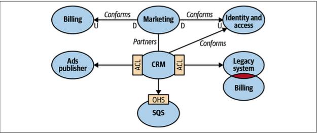

# Implementación 

La lógica empresarial es la parte más importante del software. Es la razón por la que se implementa el software en primer lugar. La interfaz de usuario de un sistema puede ser atractiva y su base de datos puede ser extremadamente rápida y escalable. Pero si el software no es útil para el negocio, no es más que una demostración tecnológica costosa.

## Script de Transacción
> Organiza la lógica empresarial mediante procedimientos donde cada procedimiento maneja una sola solicitud desde la presentación. "Martin Fowler"

El único requisito que deben cumplir los procedimientos es el comportamiento transaccional. Cada operación debe tener éxito o fallar, pero nunca puede dar lugar a un estado inválido. 

El asunto es que el patrón script de transacción es la base para los patrones de implementación de lógica empresarial más avanzados.

El problema de corrupción de datos puede llevar a: 
- Falta de comportamiento transaccional
- Transacciones distribuidas
- Transacciones distribuidas implícitas

## Registro Activo
> Un objeto que envuelve una fila en una tabla o vista de base de datos, encapsula el acceso a la base de datos y agrega lógica de dominio sobre esos datos.

En consecuencia, este patrón utiliza objetos dedicados, conocidos como registros activos, para representar estructuras de datos complejas.

## Sea Pragmático
Aunque los datos empresariales son importantes y el código que diseñamos y construimos debería proteger su integridad, hay casos en los que un enfoque pragmático es más deseable.
Especialmente a niveles altos de escala, hay casos en los que las garantías de consistencia de datos pueden relajarse. Verifique si corromper el estado de un registro de cada millón es realmente un obstáculo insuperable para el negocio y si puede afectar negativamente el rendimiento y la rentabilidad del negocio. Por ejemplo, supongamos que está construyendo un sistema que ingiere miles de millones de eventos por día desde dispositivos IoT. ¿Es un gran problema si el 0.001% de los eventos se duplican o se pierden?
Como siempre, no hay leyes universales. Todo depende del dominio empresarial en el que esté trabajando. Está bien “recortar esquinas” donde sea posible; solo asegúrese de evaluar los riesgos y las implicaciones comerciales.

# Modelo de Dominio

El patrón modelo de dominio está destinado a manejar casos de lógica empresarial compleja. Aquí, en lugar de interfaces CRUD, nos enfrentamos a transiciones de estado complejas, reglas comerciales e invariantes: reglas que deben protegerse en todo momento.

Un modelo de dominio es un modelo de objetos del dominio que incorpora tanto comportamiento como datos. Los patrones tácticos del DDD: agregados, objetos valor, eventos de dominio y servicios de dominio, son los bloques de construcción de dicho modelo de objetos.

La lógica empresarial del dominio ya es inherentemente compleja, por lo que los objetos utilizados para modelarla no deben introducir complejidades accidentales adicionales. El modelo debe estar exento de cualquier preocupación infraestructural o tecnológica, como implementar llamadas a bases de datos u otros componentes externos del sistema. Esta restricción requiere que los objetos del modelo sean objetos simples (POJO), objetos que implementan lógica empresarial sin depender ni incorporar directamente ningún componente infraestructural o marco de trabajo.

## Bloques de Construcción

### Objeto Valor
Un objeto valor es un objeto que puede identificarse por la composición de sus valores.

Cuándo usar objetos valor. La respuesta simple es: siempre que pueda.

ejemplo: 
```java
class Person {
    private PersonId _id; 
    private Name _name; 
    private PhoneNumber _landline; 
    private PhoneNumber _mobile; 
    private EmailAddress _email; 
    private Height _height; 
    private CountryCode _country;
    
    public Person(...) { ... } 
}

static void Main(string[] args) {
    var dave = new Person(
        id: new PersonId(30217),
        name: new Name("Dave", "Ancelovici"), 
        landline: PhoneNumber.Parse("023745001"), 
        mobile: PhoneNumber.Parse("0873712503"), 
        email: Email.Parse("dave@learning-ddd.com"), height: Height.FromMetric(180),
        country:  CountryCode.Parse("BG"));
    )
    // ...
}
```

## Agregados

Una jerarquía de entidades que comparten un límite transaccional. Todos los datos incluidos dentro del límite de un agregado deben tener una consistencia fuerte para implementar su lógica empresarial.

Un agregado es una entidad: requiere un campo de identificación explícito y se espera que su estado cambie durante el ciclo de vida de una instancia. Sin embargo, es mucho más que una simple entidad. El objetivo del patrón es proteger la consistencia de sus datos. Dado que los datos de un agregado son mutables, existen implicaciones y desafíos que el patrón debe abordar para mantener su estado consistente en todo momento.

**El estado de un agregado solo puede modificarse mediante su propia lógica empresarial. Además, ninguna operación del sistema puede asumir una transacción multi-agregado. Un cambio en el estado de un agregado solo puede confirmarse de forma individual, un agregado por transacción de base de datos.**

El DDD prescribe que el diseño de un sistema debe estar impulsado por su dominio empresarial. Los agregados no son una excepción. Para apoyar cambios en múltiples objetos que deben aplicarse en una sola transacción atómica, el patrón de agregado se asemeja a una jerarquía de entidades, todas compartiendo consistencia transaccional.

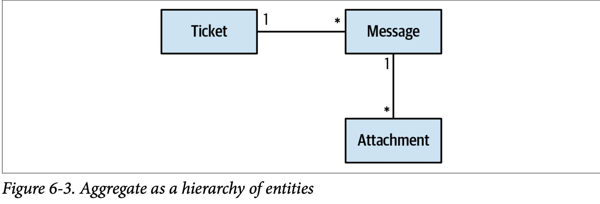

La jerarquía contiene tanto entidades como objetos valor, y todos pertenecen al mismo agregado si están vinculados por la lógica empresarial del dominio.
Por eso el patrón se llama “agregado”: agrupa entidades comerciales y objetos valor que pertenecen al mismo límite transaccional.

Dado que todos los objetos contenidos por un agregado comparten el mismo límite transaccional, pueden surgir problemas de rendimiento y escalabilidad si un agregado crece demasiado.

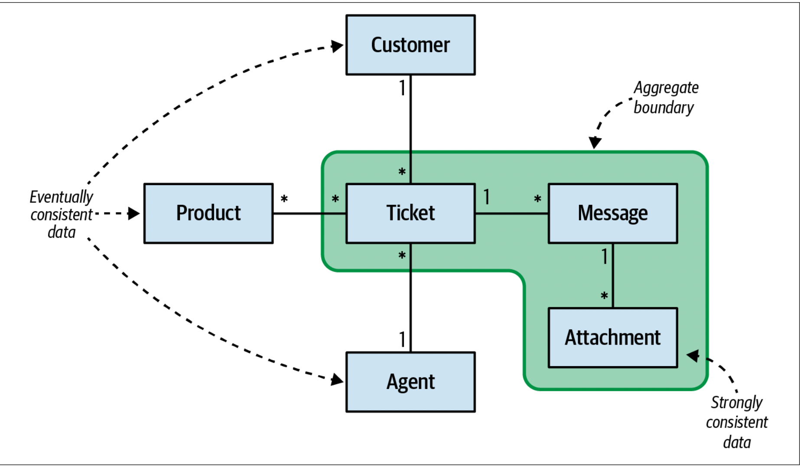

## Servicios de Dominio

Un servicio de dominio es un objeto sin estado que implementa lógica empresarial. En la gran mayoría de los casos, dicha lógica orquesta llamadas a varios componentes del sistema para realizar algún cálculo o análisis.

# Patrones Arquitectónicos

La variedad de preocupaciones que una base de código debe gestionar facilita que su lógica empresarial se difunda entre los diferentes componentes: es decir, que parte de la lógica se implemente en la interfaz de usuario o en la base de datos, o se duplique en diferentes componentes.

La falta de una organización estricta en las preocupaciones de implementación hace que la base de código sea difícil de cambiar. Cuando la lógica empresarial debe cambiar, puede no ser evidente qué partes de la base de código deben verse afectadas. El cambio puede tener efectos inesperados en partes del sistema que parecen no estar relacionadas. Por el contrario, puede ser fácil pasar por alto código que debe modificarse. Todos estos problemas aumentan drásticamente el costo de mantener la base de código.

## Arquitectura en Capas

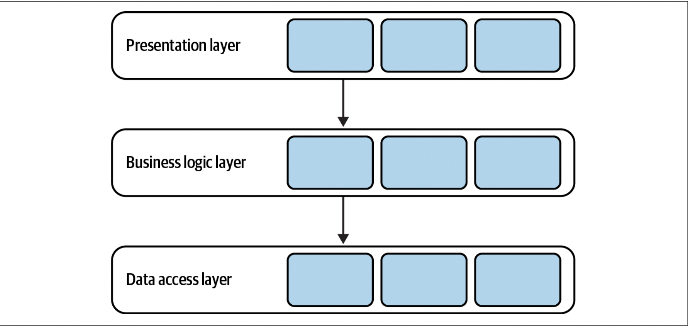

En su forma clásica, la arquitectura en capas consiste en tres capas: la capa de presentación (PL), la capa de lógica empresarial (BLL) y la capa de acceso a datos (DAL).

- Capa de presentación = capa de interfaz de usuario
- Capa de servicio = capa de aplicación
- Capa de lógica empresarial = capa de dominio = capa de modelo
- Capa de acceso a datos = capa de infraestructura

## Puertos y Adaptadores

La arquitectura de puertos y adaptadores aborda las deficiencias de la arquitectura en capas y se ajusta mejor para la implementación de lógica empresarial más compleja. Curiosamente, ambos patrones son bastante similares.

El principio de inversión de dependencias (DIP) establece que los módulos de alto nivel, que implementan la lógica empresarial, no deben depender de módulos de bajo nivel. Sin embargo, eso es precisamente lo que ocurre en la arquitectura en capas tradicional. La capa de lógica empresarial depende de la capa de infraestructura. 

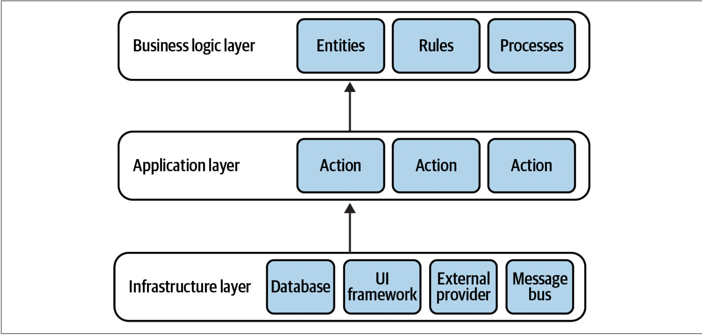

El objetivo principal de la arquitectura de puertos y adaptadores es desacoplar la lógica empresarial del sistema de sus componentes infraestructurales.

## Segregación de Responsabilidades de Comandos y Consultas (CQRS)

El patrón de segregación de responsabilidades de comandos y consultas (CQRS) se basa en los mismos principios organizacionales para la lógica empresarial y las preocupaciones infraestructurales que los puertos y adaptadores. Sin embargo, difiere en la forma en que se gestionan los datos del sistema. Este patrón permite representar los datos del sistema en múltiples modelos persistentes.

Otra razón para trabajar con múltiples modelos puede estar relacionada con la noción de persistencia políglota. No existe una base de datos perfecta. O, como dice Greg Young6, todas las bases de datos tienen defectos, cada una a su manera: a menudo debemos equilibrar las necesidades de escala, consistencia o modelos de consulta soportados.

Originalmente, CQRS se definió para abordar las posibilidades de consulta limitadas de un modelo basado en eventos: solo es posible consultar eventos de una instancia de agregado a la vez.

Como su nombre indica, el patrón segrega las responsabilidades de los modelos del sistema. Existen dos tipos de modelos: el modelo de ejecución de comandos y los modelos de lectura.

CQRS dedica un único modelo a ejecutar operaciones que modifican el estado del sistema (comandos del sistema). Este modelo se utiliza para implementar la lógica empresarial, validar reglas y hacer cumplir invariantes.

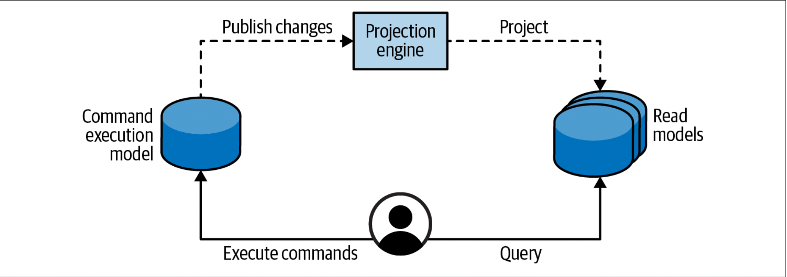

### Proyección de Modelos de Lectura

1. Síncrono

Para que la suscripción de recuperación funcione, el modelo de ejecución de comandos debe realizar un punto de control (checkpoint) de todos los registros agregados o actualizados en la base de datos. El mecanismo de almacenamiento también debe admitir la consulta de registros basados en el punto de control.

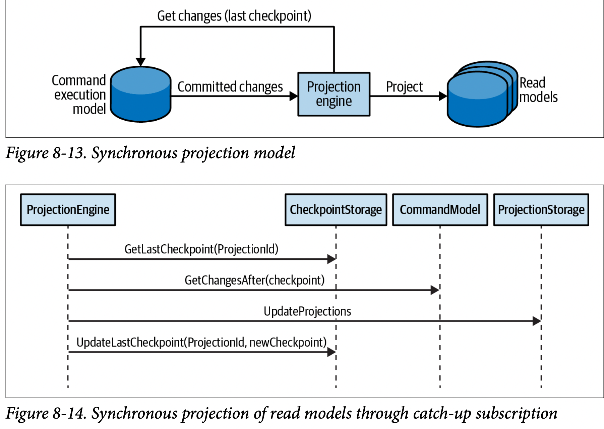

2. Proyecciones asíncronas

En el escenario de proyección asíncrona, el modelo de ejecución de comandos publica todos los cambios confirmados en un bus de mensajes. Los motores de proyección del sistema pueden suscribirse a los mensajes publicados y usarlos para actualizar los modelos de lectura.

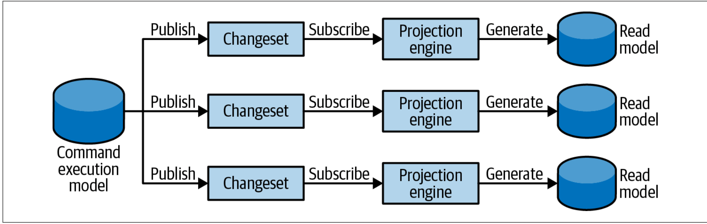

# EventStorming

EventStorming es una actividad de baja tecnología para que un grupo de personas realice una lluvia de ideas y modele rápidamente un proceso empresarial. En cierto sentido, EventStorming es una herramienta táctica para compartir conocimiento del dominio empresarial.

Una sesión de EventStorming tiene un alcance: el proceso empresarial que el grupo está interesado en explorar.
